# odysseus-desktop

Bureau Wayland personnel en Rust : rapide, sobre.

> ⚠️ **Travail d'exploration — à ne pas utiliser en production.**
> Ce dépôt est un terrain d'expérimentation personnel, construit pour une seule
> machine (Linux From Scratch, GPU AMD, écran 4K, clavier AZERTY). Il n'est ni
> audité, ni testé au-delà de cette machine, ni maintenu pour d'autres usages :
> l'écran de verrouillage, la gestion de session et le compositeur n'offrent
> aucune garantie de sécurité ou de stabilité. Les chemins, réglages et choix
> matériels y sont souvent codés en dur.
>
> *Exploratory work — not for production use. Personal experiment built for a
> single machine; no security or stability guarantees.*

**Mode d'emploi : [le guide d'odysseus](docs/guide.md)**, fonction par fonction.

## Aperçu

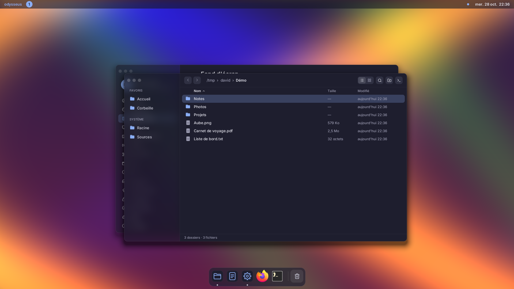

| Centre de contrôle | Centre de notifications |
|---|---|
| 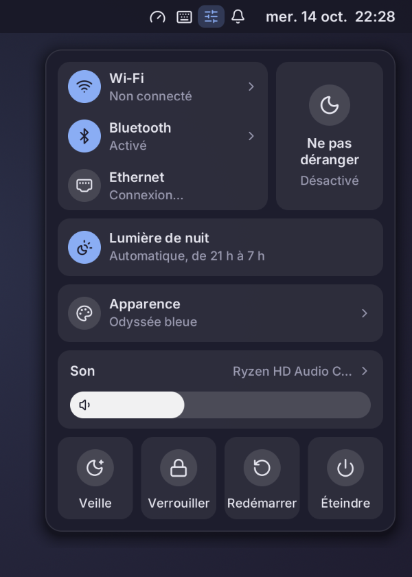 | 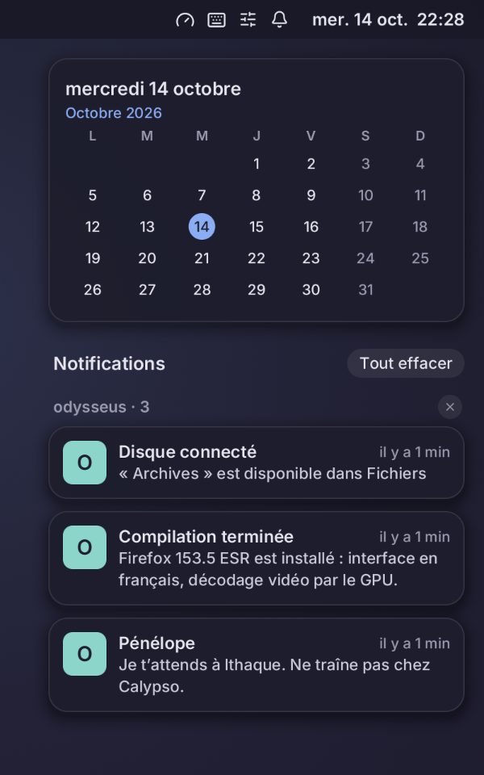 |

| Moniteur système |
|---|
| 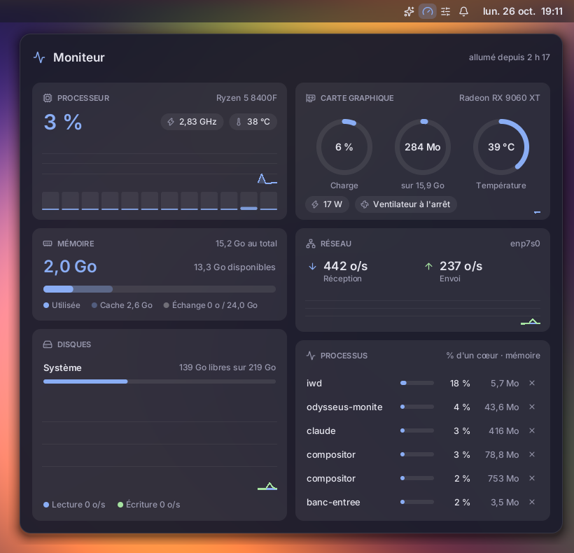 |

| Fichiers (tri, panneau d'informations) | Lanceur (Super+Espace) |
|---|---|
| 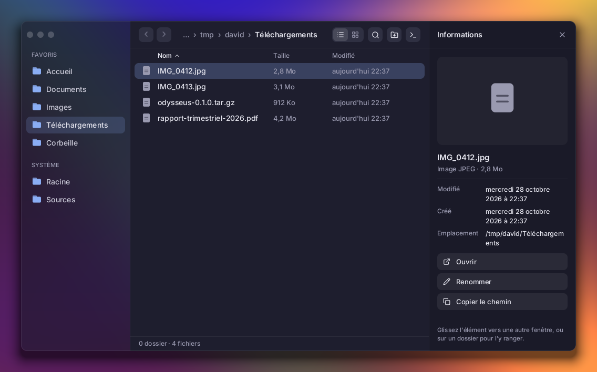 | 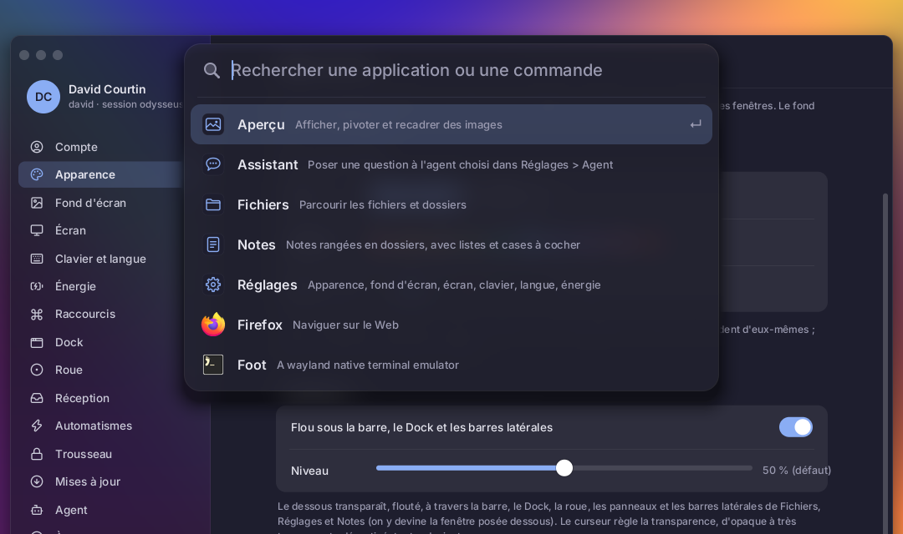 |

| Assistant (icône de la barre ou Super+A) : l'agent choisi, avec les outils du bureau |
|---|
| 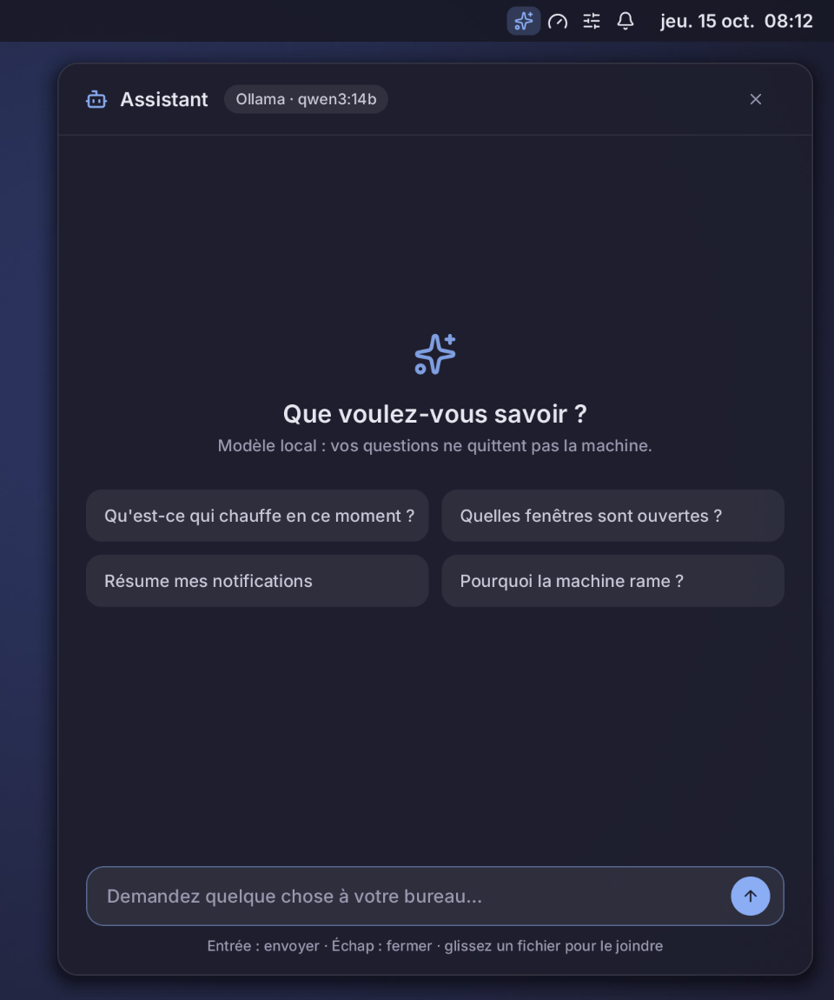 |

| Automatismes : à la demande, à heure fixe, à l'arrivée d'un fichier ; créés par l'Assistant, validés par vous |
|---|
| 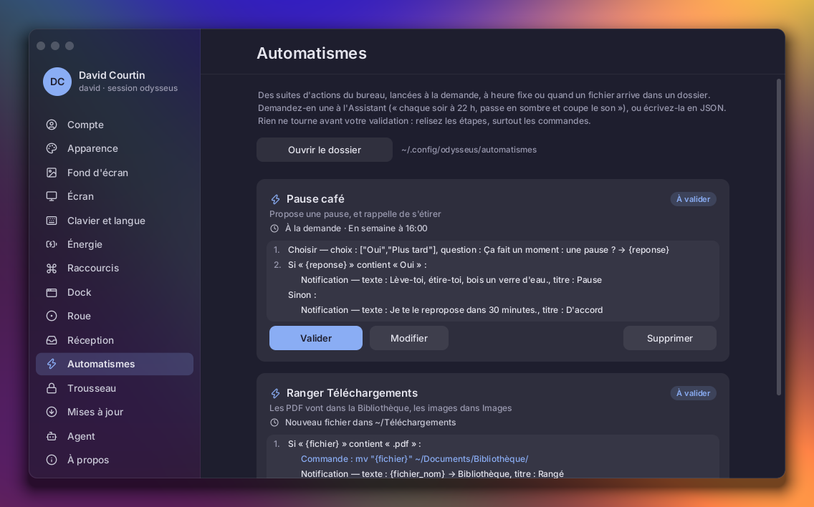 |

| Partage d'écran (visioconférence dans Firefox…) : l'écran entier ou une fenêtre, choisis sur vignettes ; un témoin dans la barre, un clic l'arrête |
|---|
| 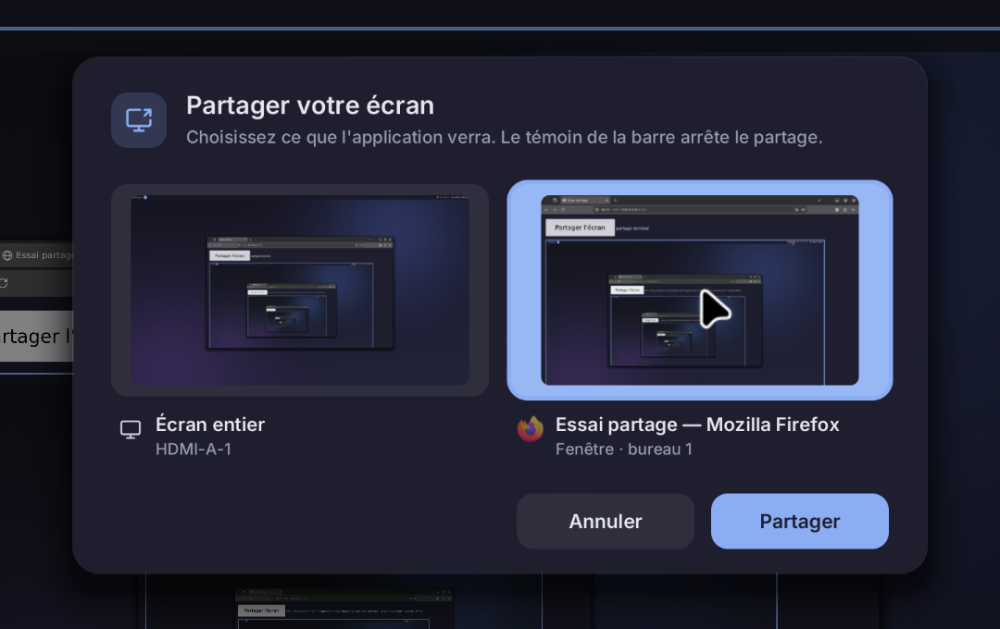 |

| Trousseau : les mots de passe des applications, ouverts à la connexion ; demande à la manière d'odysseus quand il le faut |
|---|
| 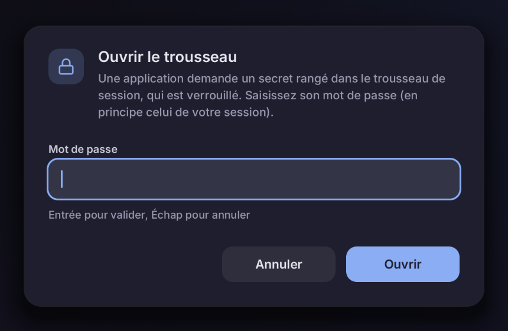 |

| Notes : dossiers, recherche sans accents, texte mis en forme (titres, gras, listes, cases à cocher), corbeille de 30 jours |
|---|
| 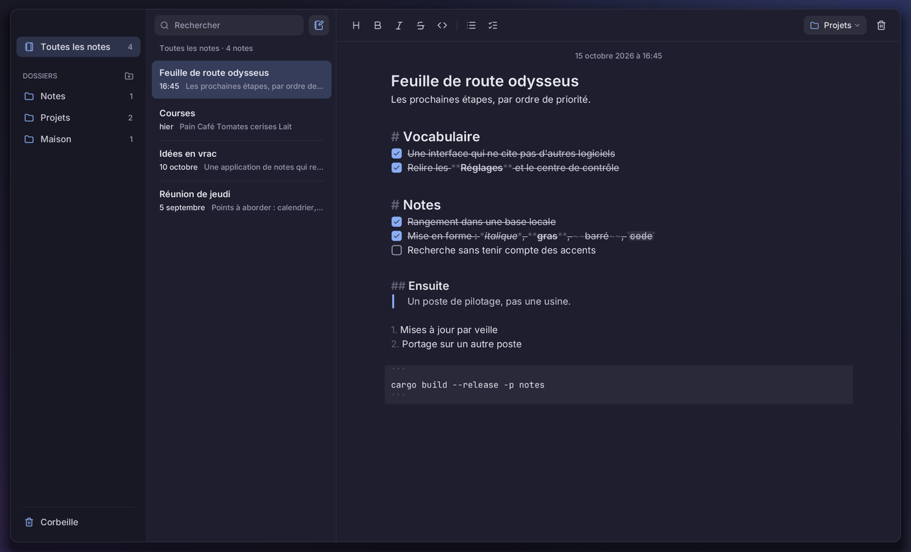 |

| Réglages : fond d'écran, et six autres pages |
|---|
| 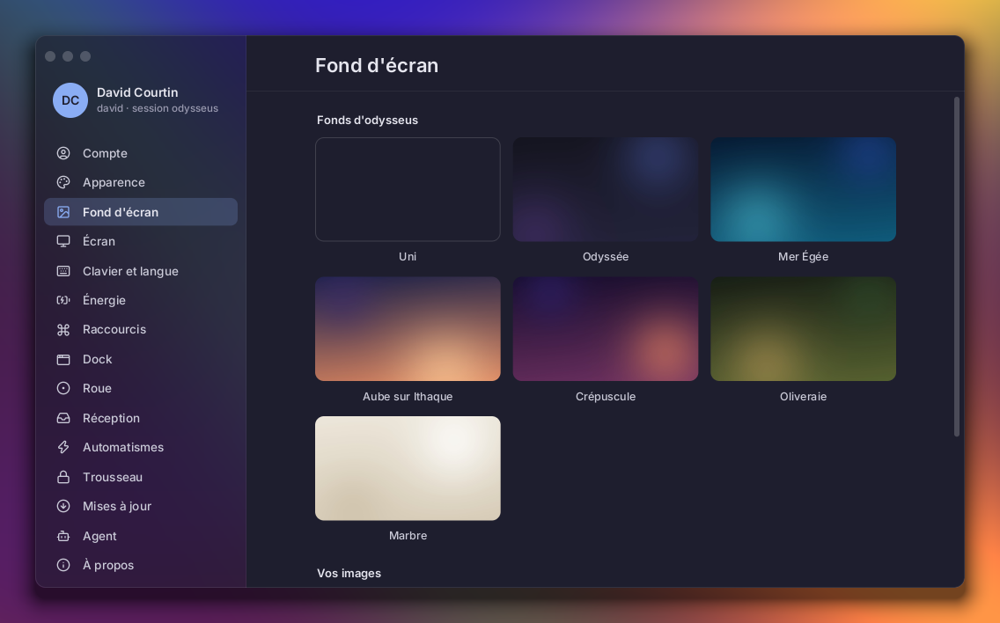 |

| Aide-mémoire des raccourcis (Super+K) |
|---|
| 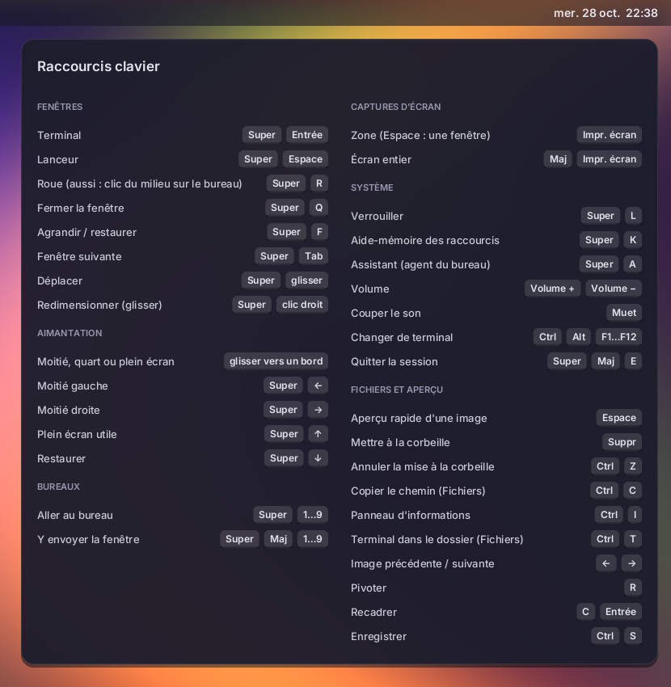 |

| Thèmes : Odyssée bleue, sombre et claire |
|---|
| 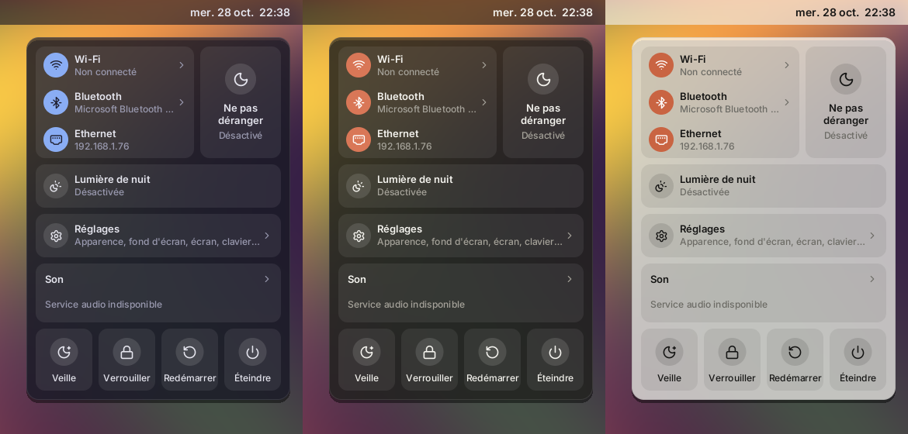 |

| Aperçu (visionneuse d'images) |
|---|
| 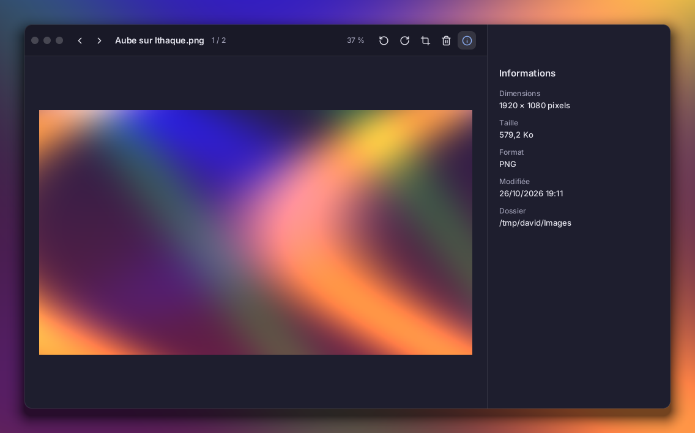 |

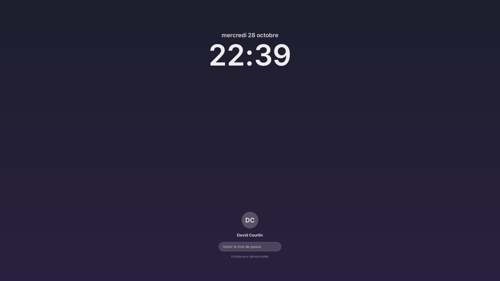

*Captures faites par le compositeur lui-même, en 4K à l'échelle 1,5, avec un fond
dégradé de démonstration. Notifications, dossier « Démo » et disque « Archives » de
démonstration ; les images sont des fractales de Mandelbrot générées par FFmpeg. Dans
la barre, l'icône du panneau ouvert est en surbrillance.*

| Dossier | Rôle | État |
|---|---|---|
| `common/` | Thème (couleurs, grille de 4 px, typographie) et dessin logiciel partagé (`draw`) | base |
| `compositor/` | Compositeur Smithay : fenêtres arrondies + ombres, animations (ouverture, fermeture, glissement entre bureaux, trajets d'aimantation), aimantation des fenêtres, redimensionnement par les bords (curseur assorti), barre de titre avec boutons fermer / réduire / agrandir pour les fenêtres qui laissent la décoration au compositeur, réduction des fenêtres, bureaux 1–9, coin actif (haut droit : notifications), glisser-déposer entre applications, presse-papiers accessible en ligne de commande (data-control), captures d'écran, partage d'écran (ext-image-copy-capture et ext-foreign-toplevel-list : un écran ou une fenêtre, image copiée seulement quand elle change, rien pendant le verrouillage), lumière de nuit, IPC compatible sway, backends winit et DRM | fonctionne (imbriqué et sur tty) |
| `shell-bar/` | Barre du haut : bureaux (clic, molette) ; à droite les icônes des applications (zone de notification StatusNotifierItem : la barre tient le registre, clic gauche pour l'action de l'application, clic droit pour son menu dbusmenu, clic du milieu pour l'action secondaire), puis le témoin « Partage » (écran partagé ; un clic arrête le partage), l'icône des mises à jour (quand il y en a à décider ; rouge pour la sécurité), Assistant, moniteur (jauge colorée selon la charge), centre de contrôle, cloche des notifications (point : non vues), date et heure ; l'icône du panneau ouvert est en surbrillance | fonctionne sous sway et odysseus |
| `dock/` | `odysseus-dock` : Dock en bas de l'écran (couche « top », sans zone réservée) — favoris (`~/.config/odysseus/dock`), applis ouvertes, corbeille ; point sous une appli ouverte, anneau pour ses fenêtres réduites ; clic : lancer ou ramener (menu s'il y a plusieurs fenêtres), clic du milieu : nouvelle fenêtre, clic droit : fenêtres, garder / retirer, quitter ; masquage intelligent (une fenêtre passe dessous), toujours ou jamais, bord du bas pour le faire revenir ; fenêtres lues par l'IPC (GET_WINDOWS) | fonctionne |
| `notify/` | `odysseus-notify` : notifications (D-Bus standard), bannières, centre de notifications avec calendrier (cloche, heure ou coin actif), « Ne pas déranger », indicateur de volume ; backend « odysseus » de xdg-desktop-portal pour les réglages d'apparence (Firefox et GTK suivent le thème clair ou sombre) ; demandes de mot de passe du trousseau (interface CliPrompter d'oo7) | fonctionne |
| `control/` | `odysseus-control` : centre de contrôle ; `odysseus-raccourcis` : aide-mémoire des raccourcis ; (Wi-Fi via iwd, Bluetooth via BlueZ, Ethernet, lumière de nuit, son via PipeWire, accès aux Réglages, veille, verrouiller, redémarrer, éteindre) | fonctionne |
| `settings/` | `odysseus-reglages` : Réglages — Apparence (thèmes), Fond d'écran (dégradés d'odysseus calculés en 4K, images de l'utilisateur, dépôt depuis Fichiers), Écran (définition avec confirmation et retour automatique, fréquence, taille, lumière de nuit : horaires et teinte), Clavier et langue (disposition, répétition, zone d'essai, langue du système via systemd-localed), Énergie (extinction, verrouillage, veille), Raccourcis, Automatismes (validation, pause, lancement, dernière exécution), Mises à jour (rapport de la veille, préparer, écarter, mettre odysseus à jour), Trousseau (trousseaux ouverts ou verrouillés, noms des secrets rangés et application, suppression ; jamais les valeurs), Agent (Claude Code et Ollama installés, mis à jour et connectés depuis la page, modèles téléchargés avec progression, neuf autorisations d'odysseus-mcp, activité ; tout vient de `~/.config/odysseus/agent.json`, modifiable à la main), À propos | fonctionne |
| `mcp/` | `odysseus-mcp` : le bureau exposé aux agents (Model Context Protocol) — état du système, écran, réglages, journaux ; documentation (man pages découpées par partie, apropos, documentation du noyau, des paquets, manuels info, notes de construction de la machine, PDF et textes de ~/Documents/Bibliothèque) ; lecture des fichiers (jamais les secrets : clés, mots de passe, historiques) ; fenêtres, notifications, captures ; actions (notifier, ouvrir, lancer une application, fermer ou déplacer une fenêtre, bureaux, son, Ne pas déranger, thème, fond, lumière de nuit, échelle) ; presse-papiers ; notes (lister, lire, écrire, mettre à la corbeille) ; commandes shell, chacune approuvée dans une notification Autoriser / Refuser. Neuf catégories autorisées ou non dans Réglages > Agent, chaque appel consigné (~/.local/state/odysseus/agent.log) | fonctionne |
| `assistant/` | `odysseus-assistant` : panneau de conversation avec l'agent choisi dans Réglages > Agent (Claude Code, Ollama ou commande personnalisée), qui passe par odysseus-mcp ; réponse en direct, outils appelés affichés, fichiers joints (glisser-déposer, Ctrl+V, depuis Fichiers), arrêt avec Échap ; panneau en haut à droite, ouvert par son icône de la barre, Super+A, « ? » ou l'entrée Assistant du lanceur, ou Fichiers > Demander à l'Assistant | fonctionne |
| `auto/` | `odysseus-auto` : automatismes façon Raccourcis d'iOS — un fichier JSON par automatisme (~/.config/odysseus/automatismes), déclencheurs à la demande (lanceur, Réglages, Assistant), à heure fixe (jours au choix) ou à l'arrivée d'un fichier dans un dossier ; étapes = outils d'odysseus-mcp, plus attendre, choisir (boutons dans une notification), agent (le modèle transforme un texte), si / alors / sinon ; variables {resultat}, {fichier}, noms gardés, passées aux commandes par l'environnement (un nom de fichier piégé n'est jamais interprété). Écrits par l'agent (outil creer_automatisme) ou à la main, ils ne tournent qu'une fois validés dans Réglages > Automatismes ; toute modification demande une nouvelle validation | fonctionne |
| `partage/` | `odysseus-partage` : sélecteur du partage d'écran, appelé par xdg-desktop-portal-wlr — vignettes de l'écran et des fenêtres (icône de l'application, bureau), Annuler / Partager, clavier et souris | fonctionne |
| `trousseau/` | `odysseus-trousseau` : fenêtre de mot de passe du trousseau (ouvrir, créer, changer), lancée par odysseus-notify à la demande d'oo7-daemon ; le mot de passe est écrit directement à oo7, sans passer par notify | fonctionne |
| `notes/` | `odysseus-notes` : Notes — dossiers (créer, renommer d'un double-clic, supprimer), liste des notes avec aperçu et recherche sans tenir compte des accents ni de la casse, éditeur de Markdown léger mis en forme à l'écran, symboles visibles seulement sur la ligne du curseur (titres, gras, italique, barré, code, listes, cases à cocher cliquables, citations, blocs de code), barre d'outils et raccourcis, annuler / rétablir, presse-papiers ; enregistrement automatique dans `~/.local/share/odysseus/notes.db` (SQLite), corbeille gardée 30 jours ; ce qu'écrit un agent (odysseus-mcp) apparaît aussitôt ; `--nouvelle` ouvre une note vierge | fonctionne |
| `veille/` | `odysseus-veille` : recherche quotidienne des mises à jour (minuterie systemd utilisateur `odysseus-veille.timer`), sans rien installer — logiciels de /sources comparés à release-monitoring.org (noyau : kernel.org, Firefox ESR : Mozilla), avis de sécurité LFS/BLFS, commits d'odysseus, chaîne Rust ; rapport dans `~/.local/state/odysseus/mises-a-jour.json`, notification de ce qui est nouveau ; icône dans la barre, décision au cas par cas dans Réglages > Mises à jour (préparer avec l'Assistant, écarter une version, mettre odysseus à jour) | fonctionne |
| `lock/` | `odysseus-lock` : écran de verrouillage (ext-session-lock, PAM) | fonctionne |
| `launcher/` | Lanceur façon Spotlight (Mod+Espace) ; « ? question » ou dernière ligne : demander à l'Assistant | fonctionne |
| `sysmon/` | `odysseus-moniteur` : moniteur système (icône jauge de la barre, colorée selon la charge) — processeur (charge, cœurs, fréquence, température), mémoire, disques (place, débits), carte graphique AMD (charge, mémoire vidéo, température, consommation), réseau, processus les plus actifs (arrêt en deux clics) ; courbes sur 60 s | fonctionne |
| `files/` | Fichiers : explorateur (favoris, corbeille, appareils USB avec éjection, chemin cliquable, tri par nom · taille · date, panneau d'informations avec vignette et actions selon le type — décompresser une archive, terminal dans un dossier —, glisser-déposer vers d'autres fenêtres ou dans un dossier, renommage sur place — F2 ou clic droit —, menu du clic droit, nouveau dossier, copier · couper · coller — Ctrl+C, Ctrl+X, Ctrl+V, compatibles avec les autres explorateurs —, vue en liste ou en icônes avec vignettes — Ctrl+1, Ctrl+2 —, recherche — Ctrl+F, dans le dossier ou les sous-dossiers, sans casse ni accents —, dupliquer, compresser en .zip, aller à un chemin tapé avec complétion, Ctrl+glisser pour copier, dépôt de fichiers venant d'autres applications, sélection multiple — zone de sélection à la souris, Ctrl+clic, Maj+clic, Ctrl+A — et actions par lot) | fonctionne |
| `preview/` | `apercu` : visionneuse d'images (dossier parcouru aux flèches, zoom vers le pointeur, rotation, recadrage, infos EXIF, corbeille) | fonctionne |

## Raccourcis (Mod = Super sur tty, Alt dans une fenêtre sway)

| Touches | Action |
|---|---|
| Mod+Entrée | terminal |
| Mod+Espace | lanceur |
| Mod+q | fermer la fenêtre |
| Mod+glisser | déplacer la fenêtre |
| bord ou coin d'une fenêtre glissé (juste à l'extérieur), ou Mod+clic droit glissé | redimensionner |
| Mod+f | agrandir / restaurer |
| Mod+m | réduire la fenêtre active |
| boutons de la barre de titre | fermer, réduire, agrandir (Alt+clic : plein écran) ; double-clic sur la barre : agrandir |
| Mod+Tab | fenêtre suivante |
| glisser une fenêtre contre un bord | aimantation : moitié (gauche/droite), plein (haut), quart (coins) ; la décrocher lui rend sa taille |
| Mod+← / Mod+→ / Mod+↑ / Mod+↓ | moitié gauche / droite / agrandir / restaurer |
| Mod+1…9 / Mod+Maj+1…9 | aller au bureau / y envoyer la fenêtre |
| Impr. écran ou Mod+Maj+s | capture d'une zone (glisser) ; Espace : d'une fenêtre (avec son ombre) ; Échap : annuler |
| Maj+Impr. écran | capture de l'écran entier |
| Mod+a | Assistant (Entrée : envoyer, ↑ : rappeler, Ctrl+L : nouvelle conversation, Échap : arrêter puis fermer) |
| Mod+l | verrouiller |
| Mod+k (ou Réglages > Raccourcis) | aide-mémoire des raccourcis |
| touches Volume +/−, Muet | volume (avec indicateur) |
| icônes d'applications de la barre | clic : action de l'application (souvent afficher ou masquer sa fenêtre) ; clic droit : son menu (↑ ↓, Entrée, Échap) |
| icônes de la barre (de gauche à droite) | Assistant, moniteur système, centre de contrôle (dont l'accès aux Réglages) |
| cloche de la barre, clic sur l'heure, ou souris dans le coin en haut à droite | centre de notifications (point sur la cloche : notifications non vues) |
| Ctrl+Alt+F1…F12 | changer de tty |
| Mod+Maj+e | quitter |

Réglages (`odysseus-reglages`, ou centre de contrôle > Réglages) : enregistrés dans
`~/.config/odysseus/reglages` (« clé = valeur ») et `theme`, relus à chaud par le
compositeur et les applications. Ils priment sur les variables d'environnement
(`ODYSSEUS_SCALE`, `ODYSSEUS_IDLE`, `ODYSSEUS_NIGHT_*`, `XKB_DEFAULT_*`), qui restent
les valeurs par défaut sans fichier de réglages. Thèmes : Odyssée bleue (par défaut),
sombre et claire. Une nouvelle définition d'écran revient d'elle-même à l'ancienne
au bout de 15 s si on ne la garde pas.

Échelle par défaut : déduite de la densité de l'écran (environ 110 points par pouce,
au quart près). Écran : branché à chaud (ODYSSEUS_OUTPUT est l'écran préféré, sinon le premier
connecté). Par IPC (`SWAYSOCK`) : `output scale 1.25`, `output mode 2560x1440@60`,
`nightlight on|off|auto|toggle` (auto : 21 h → 7 h, `ODYSSEUS_NIGHT_FROM/TO/TEMP`).

Fichiers et Aperçu : Espace (Fichiers : ouvrir, une image dans l'Aperçu), Entrée (Fichiers : renommer), Suppr (corbeille, au
format freedesktop), Ctrl+Z (annuler ; dans Fichiers, aussi un renommage, un déplacement, un collage, une copie, un nouveau dossier). Fichiers : clic sur un en-tête (trier,
second clic pour inverser), clic sur un élément (panneau d'informations : copier
le chemin, copier l'image, ouvrir, décompresser, terminal, demander à l'Assistant, corbeille), Ctrl+Maj+C (copier
le chemin), Ctrl+C / Ctrl+X / Ctrl+V (copier, couper, coller des fichiers), F2 (renommer), Ctrl+Maj+N (nouveau dossier), clic droit (menu), glisser depuis le vide (zone de sélection), Ctrl+I (panneau), Ctrl+T (terminal dans le dossier affiché), double-clic sur
une archive (décompression à côté : zip, tar, gz, xz, bz2, zst), glisser un élément vers une autre fenêtre (un terminal reçoit son
chemin) ou sur un dossier (déplacement). Aperçu : ← → (image précédente / suivante),
molette (zoom), 0 / 1 (ajuster / taille réelle), R (pivoter), C puis Entrée
(recadrer), I (infos), F (plein écran), Ctrl+S / Ctrl+Maj+S (enregistrer / une copie).

Presse-papiers : `wl-copy` / `wl-paste` (protocole data-control) ; une capture
copiée se colle telle quelle, par exemple dans Claude Code avec Ctrl+V.

Captures d'écran : enregistrées dans `~/Images` (« Capture d’écran AAAA-MM-JJ à HH.MM.SS.png »),
copiées dans le presse-papiers et annoncées par une notification avec vignette (clic : Aperçu).

Clavier Apple (fabricant USB 05ac) : branché, la disposition passe en Français (Mac) ;
retiré, elle revient au PC. Variables : `XKB_DEFAULT_LAYOUT`, `XKB_DEFAULT_VARIANT`, `XKB_DEFAULT_OPTIONS`.

Animations : `ODYSSEUS_ANIM_SLOW=10` les ralentit toutes dix fois (pour les régler à l'œil).

Diagnostic : `ODYSSEUS_FPS=1` journalise toutes les 5 s le nombre d'images envoyées à
l'écran et les éléments qui ont changé ; au repos, rien ne doit être envoyé.

Inactivité (Réglages > Énergie) : l'écran s'éteint au bout de 10 min et la session se
verrouille, puis, si demandé, l'ordinateur se met en veille ; une vidéo en lecture
l'empêche.

## Commandes

    ./odysseus-session.sh          # session complète sur un tty (lancée d'office sur tty1, sway en secours sur tty2)

    odysseus-notify --send "Titre" "Texte"   # notification d'essai
    odysseus-notify --dnd toggle             # « Ne pas déranger »
    odysseus-control --vue wifi              # centre de contrôle, vue Wi-Fi
    odysseus-notify --center [show]          # centre de notifications (bascule, ou ouvre)
    odysseus-moniteur                        # moniteur système (bascule)
    odysseus-reglages [ecran|fond|clavier…]  # Réglages, sur une page donnée
    odysseus-assistant [--joindre f] ["question"]  # Assistant (bascule), question posée d'emblée
    odysseus-veille [verifier|etat]          # chercher les mises à jour, ou résumer la dernière recherche
    odysseus-auto lancer "Pause café"      # lancer un automatisme validé (odysseus-auto liste : tous)

    cargo build --release          # tout compiler
    cargo run -p shell-bar         # lancer la barre (depuis un terminal dans sway)
    cargo clippy --workspace       # vérifications

Pour lancer la barre au démarrage de sway, ajouter dans `~/.config/sway/config` :

    exec ~/odysseus-desktop/target/release/shell-bar

## Agents (MCP)

`odysseus-mcp` parle le Model Context Protocol sur l'entrée et la sortie standard. Pour
le brancher sur Claude Code (une fois) :

    claude mcp add odysseus -s user -- ~/odysseus-desktop/target/release/odysseus-mcp

Catégories, réglées dans Réglages > Agent (ou dans `~/.config/odysseus/agent.json`, clé
`autorisations`) : lire l'état du système, lire la documentation, voir le bureau
(permises par défaut) ; lire les fichiers, notes, voir l'écran, agir sur le bureau,
presse-papiers, exécuter des commandes (refusées par défaut). Un refus est expliqué à l'agent ; chaque appel est consigné dans
`~/.local/state/odysseus/agent.log` et affiché dans Réglages. Pendant une capture, un œil
rouge s'allume dans la barre. Lancé par un agent qui tourne en root, le serveur prend
l'identité de l'utilisateur du bureau. Le compositeur offre pour cela, par IPC, la liste
des fenêtres (`GET_WINDOWS`, 100), `focus <id>` et `agent-capture <fichier> [<id>]` ;
pour la barre, les partages d'écran en cours (`GET_SCREENCAST`, 101) et `screencast stop`.

Agent local : Réglages > Agent installe Ollama (archive officielle, empreinte SHA-256
vérifiée, dans `~/.local/opt/ollama`, service utilisateur systemd ; bibliothèques NVIDIA
retirées sur une carte AMD) et télécharge les modèles du catalogue de `agent.json`
(clé `modeles_conseilles`, à compléter librement). Sur une carte AMD, le calcul passe par
Vulkan (Mesa RADV) : `/dev/dri/renderD*` doit appartenir au groupe `render` (règle udev
de systemd ; le groupe doit exister).

## Dépendances système

Au-delà de Smithay et des bibliothèques Wayland : PipeWire et WirePlumber (son),
iwd (Wi-Fi), BlueZ (Bluetooth), logind et polkit (veille, arrêt), PAM (verrou),
wl-clipboard (`wl-copy` / `wl-paste`), librsvg (icônes SVG), hwdata (nom de la carte
graphique). Partage d'écran : xdg-desktop-portal et xdg-desktop-portal-wlr (0.8 ou plus,
pour ext-image-copy-capture), avec `/usr/share/xdg-desktop-portal/odysseus-portals.conf`
(Settings → odysseus, ScreenCast → wlr) et `odysseus.portal` ; la session écrit la
configuration de xdg-desktop-portal-wlr (`~/.config/xdg-desktop-portal-wlr/odysseus`).
Trousseau : oo7-daemon 0.7 (Secret Service, unité systemd utilisateur), libsecret pour les
applications, `git-credential-oo7` ; le module `pam_oo7.so` ouvre le trousseau avec le mot de
passe de connexion (lignes à ajouter dans `/etc/pam.d/login` et `/etc/pam.d/passwd`).
Notes : SQLite (bibliothèque système, liée par rusqlite).
Mises à jour : curl et git ; la minuterie s'installe avec
`cp veille/data/odysseus-veille.* ~/.config/systemd/user/ && systemctl --user enable --now odysseus-veille.timer`.
Températures : `k10temp` (processeur AMD) et `amdgpu`.

## Installation

Sur une distribution courante (essayé sur Debian 13), après les paquets de
compilation ci-dessous et Rust :

    tools/installer.sh --tty1          # compile, installe dans /usr/local (sudo pour les copies)
    tools/installer.sh --desinstaller  # retire tout ce qui a été posé

Binaires dans `/usr/local/lib/odysseus`, session `/usr/local/bin/odysseus-session`
(aussi proposée aux gestionnaires de connexion), polices et icônes dans
`/usr/local/share/odysseus`, entrées du lanceur, services D-Bus, portails et PAM du
verrouillage. `--tty1` lance la session à la connexion sur tty1. Paquets utiles à
l'exécution (Debian) : `pipewire pipewire-pulse wireplumber foot wl-clipboard
librsvg2-bin dbus-user-session xdg-desktop-portal xdg-desktop-portal-wlr
adwaita-icon-theme fonts-noto-color-emoji` ; l'installateur signale ceux qui manquent.

## Portabilité

Le bureau ne dépend plus de cette machine pour démarrer : polices livrées dans
`data/fonts` (Inter, JetBrains Mono, Lucide ; cherchées via `common::data` dans
`$ODYSSEUS_DATA`, à côté des binaires, `/usr/share/odysseus`, puis le système),
script de session qui trouve ses binaires à côté de lui, échelle et écran
automatiques, curseur Bibata ou Adwaita. Essais sur une Debian neuve dans une
machine virtuelle : `tools/vm.sh` (qemu + KVM, installation sans intervention).
Compilation sur Debian 13 : `build-essential pkg-config libwayland-dev
libxkbcommon-dev libudev-dev libinput-dev libgbm-dev libseat-dev libdrm-dev
libegl-dev libgles-dev libdbus-1-dev libpam0g-dev libsqlite3-dev`, et Rust (rustup).

## Licence

MIT — © 2026 David Courtin. Voir [LICENSE](LICENSE). Le compositeur est parti de
*smallvil* (Smithay, MIT) : voir `compositor/LICENSE-smithay.txt`.
Les icônes des applis d'odysseus sont des dessins originaux (céramique grecque en
formes pleines : amphore, tablette de cire, lyre, œil de proue, chouette
d'Athéna), générés par `tools/icones.py`.
